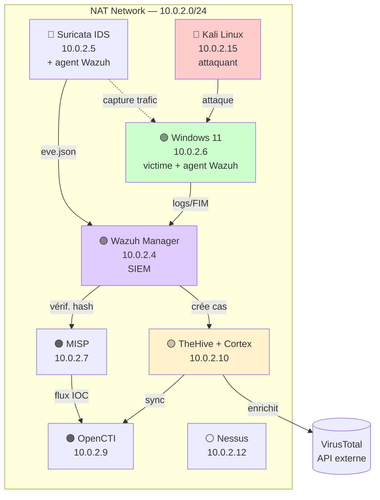
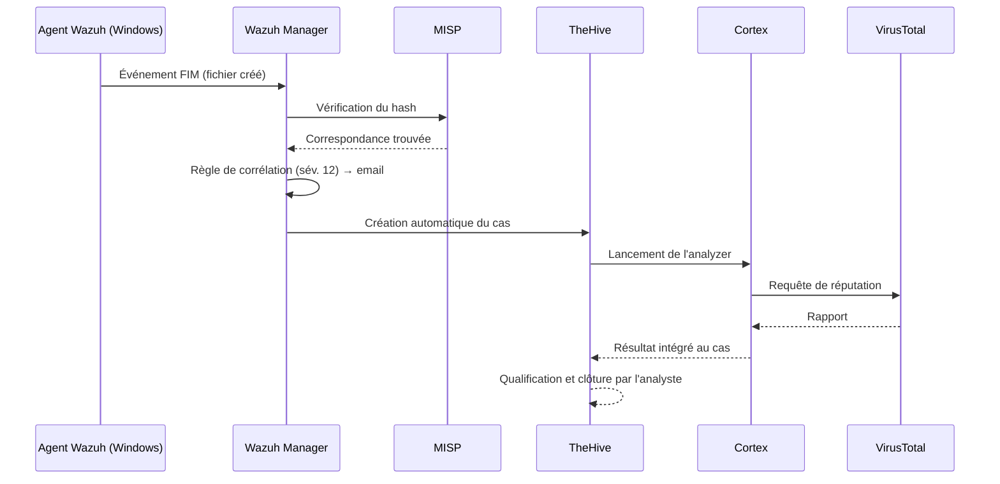

# SOC Lab — Détection, Threat Intelligence & Réponse à Incident


## Table des matières

- [Présentation
- ](#présentation)
- [Architecture](#architecture)
- [Fonctionnalités clés](#fonctionnalités-clés)
- [Pipeline de détection](#pipeline-de-détection)
- [Ma contribution](#ma-contribution)
- [Limites connues](#limites-connues)
- [Technologies](#technologies)
- [Structure du dépôt](#structure-du-dépôt)

## Présentation

Laboratoire SOC (Security Operations Center) déployé entièrement dans un environnement virtuel isolé, dans le cadre d'un stage en cybersécurité à Ménara Holding (Direction des Systèmes d'Information). Le lab reproduit les fonctions essentielles d'un SOC moderne — détection, corrélation, enrichissement et réponse à incident — sans aucune interaction avec l'infrastructure réelle de l'entreprise.

## Architecture



| Plan fonctionnel | Composants | Rôle |
|---|---|---|
| **Détection** | Suricata, Wazuh | Collecte et corrélation d'événements réseau/hôte |
| **Réponse** | TheHive, Cortex | Gestion de cas et enrichissement automatisé |
| **Connaissance** | MISP, OpenCTI | Partage d'IOC et graphe de menaces STIX 2.1 |
| **Évaluation proactive** | Nessus | Scan de vulnérabilités, indépendant du flux temps réel |

## Fonctionnalités clés

- ✅ Chaîne de détection complète validée de bout en bout
- ✅ Règles de corrélation Wazuh personnalisées (force brute SSH/RDP, hash MISP)
- ✅ Intégration MISP ↔ Wazuh via script Python (vérification de hash sur événements FIM)
- ✅ Scénarios d'attaque testés : reconnaissance Nmap, force brute SSH/RDP (Hydra), dépôt EICAR, scan Nessus

## Pipeline de détection



## Ma contribution

| Tâche | Détail |
|---|---|
| Déploiement | 7 composants, 25+ conteneurs Docker pour OpenCTI seul |
| Détection | Règles de corrélation personnalisées (100200, 100202, 100802) |
| Intégration | Scripts Python MISP ↔ Wazuh et Wazuh ↔ TheHive |
| Réseau | Plan d'adressage et redirections de ports NAT |
| Troubleshooting | Cloisonnement Cortex, clé JWT, timeout OpenSearch, saturation buffer agent |

## Limites connues

- Le ruleset Suricata gratuit (Emerging Threats Open) ne détecte pas les scans de ports ni l'énumération web — angle mort documenté, pas une erreur de configuration
- La détection de force brute RDP reste indirecte (saturation de la file d'agent plutôt qu'une signature dédiée)

## Technologies

`Wazuh 4.9` `Suricata 8.0` `TheHive 4` `Cortex` `MISP` `OpenCTI` `Docker` `VirtualBox` `Python`

## Structure du dépôt

```
docs/                  → architecture détaillée, scénarios d'attaque, captures d'écran
detection-rules/       → règles Wazuh personnalisées (local_rules.xml)
scripts/               → scripts d'intégration MISP et TheHive
```
